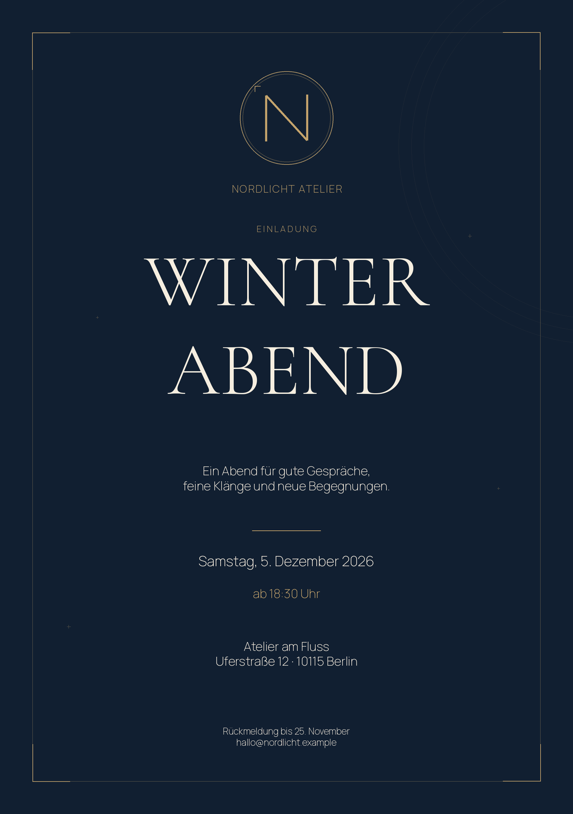

# Deine erste Einladung

Drei fertige, frei anpassbare Beispiele für ein erfundenes „Nordlicht Atelier“.
Alle Namen, Adressen und Termine sind Beispieldaten.

| Gestaltung | Vorschau | Druckdatei | Workflow |
|---|---|---|---|
| Mitternacht & Gold | [PNG ansehen](output/nordlicht-mitternacht_00001_mobil.png) | [PDF](output/nordlicht-mitternacht_00001_druck.pdf) | [Öffnen](workflows/01_Einladung_mitternacht.json) |
| Botanisch & Creme | [PNG ansehen](output/nordlicht-botanisch_00001_mobil.png) | [PDF](output/nordlicht-botanisch_00001_druck.pdf) | [Öffnen](workflows/02_Einladung_botanisch.json) |
| Modern & Koralle | [PNG ansehen](output/nordlicht-koralle_00001_mobil.png) | [PDF](output/nordlicht-koralle_00001_druck.pdf) | [Öffnen](workflows/03_Einladung_koralle.json) |

## In ComfyUI ausprobieren

1. ComfyUI öffnen und mit **Strg+F5** neu laden.
2. Links **Workflows → Einladungen → 01_Einladung_mitternacht** öffnen. Alternativ die Workflow-JSON auf die Oberfläche ziehen.
3. Oben **Ausführen** anklicken. Die erste Einladung entsteht lokal ohne zusätzliche Modell-Downloads.
4. Im großen Knoten **Deine Einladung gestalten** Texte, Datum und Ort ändern. Unter **Gestaltung** einen der drei Stile wählen; unter **Druckformat** A5, A6 oder quadratisch.
5. Im Knoten **Logo laden** dein eigenes Logo hochladen, am besten als transparentes PNG. Bild und Maske bleiben verbunden. Erneut **Ausführen** drücken.
6. Unter dem Gestaltungsknoten **PDF zum Drucken** oder **WhatsApp-PNG** anklicken. Die Dateien bleiben zusätzlich auf dem Server unter `output/einladungen/`.

Zeilenumbrüche im Titel sind erlaubt, zum Beispiel `SOMMER` und darunter `FEST`.
Die optionalen Farbfelder akzeptieren `#RRGGBB`; leer verwendet die Stilfarbe.
Mit einem zusätzlichen **Bild laden**-Knoten kannst du ein Bild mit dem Eingang
**bildhintergrund** verbinden und seine Stärke einstellen. Das Logo wird proportional
platziert; es wird nicht durch ein Bildmodell neu gezeichnet.

Deinen geänderten Workflow über ComfyUI speichern. Die erzeugten PNGs enthalten
zusätzlich den Workflow: Du kannst sie später wieder auf ComfyUI ziehen. Das jeweils
verwendete eigene Logo muss auf dem Server weiterhin verfügbar sein. Die JSON-Ausgabe
enthält die Text- und Stilwerte; sie ist kein importierbarer ComfyUI-Workflow.

## Was dieses Beispiel kann

Die Erweiterung setzt exakte Texte und ein vorhandenes Logo in feste, anpassbare
Layouts. Es ist keine freie KI-Bildgenerierung; Mikrofon und Sprachsteuerung sind
in diesem Beispiel noch nicht enthalten. Dafür läuft es ohne weitere Bildmodelle
und ohne externe Dienste.

Druck-PNG und PDF verwenden 300 dpi und das gewählte Papierformat. Das PDF ist
rasterbasiert in RGB, ohne Beschnittzugabe und ohne PDF/X-Profil. Für eine Druckerei
deren Anforderungen prüfen. Die kleinere PNG-Datei eignet sich zum Verschicken.

## Installation und Schriften

`scripts/install_extensions.sh` installiert die eigene Erweiterung, die drei Workflows
und das Beispiel-Logo. Nach erstmaliger Installation ComfyUI neu starten. Vorhandene
Eingabedateien werden nicht überschrieben.

Die mitgelieferten Schriften stammen aus Google Fonts: Cormorant Garamond und
Manrope, jeweils unter SIL Open Font License. Original-Lizenztexte stehen unter
`extensions/dgx-invitations/fonts/`. Das Beispiel-Logo ist Bestandteil dieses Projekts.
